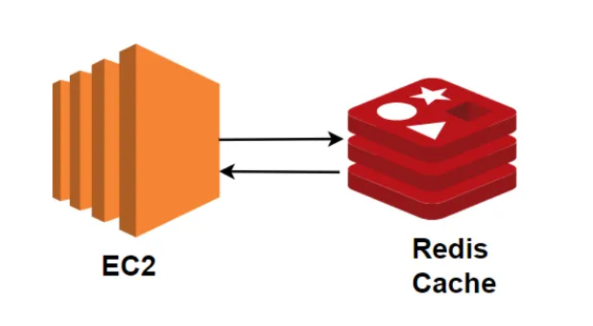
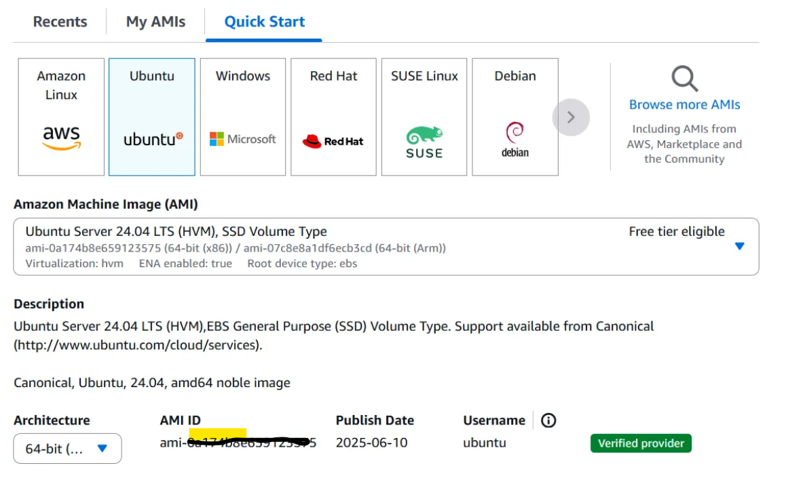

# InstallRedisDB.Ec2
Scripts and step-by-step instructions to install RedisDB on EC2 instances. These scripts facilitate quick and reliable deployment of RedisDB servers, ensuring consistent setup across environments.



### Requirements 📝
- AWS account

### Steps to create the instance 👣
- From AWS / EC2, with the region selected.
- Launch instances -> Create new instance.
- Select Quick Start -> Ubuntu and Ubuntu Server 24.04
- Ubuntu 24.04–8gb


### Steps to install Redis 👣
1. Connect to the instance and install Redis
```
sudo apt update
sudo apt install redis-server
```

2. Validate Redis
```
redis-cli --version
```

3. Change in the redis.conf
```
# Open the file with vim and write
sudo vim /etc/redis/redis.conf

# In #### GENERAL #### change 'supervised no' to:
supervised systemd

# In #### NETWORK ####
# Only if remote clients must connect directly (otherwise keep 127.0.0.1 and use an SSH tunnel, see below):
bind 0.0.0.0
# Keep protected mode enabled:
protected-mode yes
```

4. Users and authentication (ACL) in `/etc/redis/redis.conf`

> ⚠️ Adding a new user does **not** disable the `default` user, which has no password by default.
> If Redis listens on `0.0.0.0` without disabling it, anyone who reaches port 6379 gets full access.

```
# In #### SECURITY #### add:

# Disable the passwordless default user
user default off

# Application user (use a long random password: openssl rand -base64 32)
user appuser on >StrongAppPassword ~* &* +@all

# Least-privilege user used by generate-backup.sh
user backup on >StrongBackupPassword +ping +info +bgsave +lastsave
```

5. Restart Redis and verify that the default user is blocked
```
sudo systemctl restart redis

redis-cli PING                                        # must fail: NOAUTH / ERR
redis-cli --user appuser --pass StrongAppPassword PING  # PONG
```

6. Security group: open port **6379** only to your own IP (`x.x.x.x/32`), never to `0.0.0.0/0`.
   SSH (22) should also be restricted to your IP.

#### Safer alternative: do not expose 6379 🔒
Keep `bind 127.0.0.1 ::1`, do not open 6379 in the security group and connect through an SSH tunnel:
```
ssh -i key.pem -N -L 6379:127.0.0.1:6379 ubuntu@<Public IPv4 DNS>
```
Then connect your client (e.g. Redis Insight) to `127.0.0.1:6379`.

#### How to test if the instance and Redis are working correctly? ⁉️
1. Download Redis Insight to connect to the database.
2. Connect with your Public IPv4 DNS (or `127.0.0.1` through the SSH tunnel) using the `appuser` credentials.
