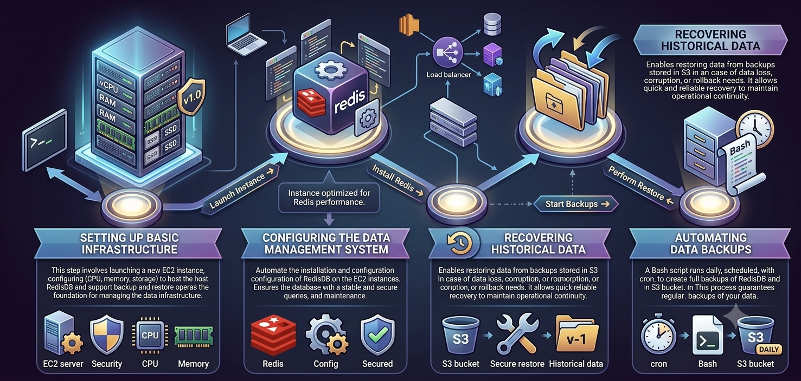

# Aws.Ec2.RedisDB.Backups.S3
Scripts to install Redis on EC2, generate RDB backups and upload them to S3, and restore them when needed. Includes steps to automate backups with cron.



#### Prerequisites 📄
| Requirement | Details |
|-------------|---------|
| **EC2** | [Create an instance on AWS EC2](https://aws.amazon.com/ec2/) |
| **Type** | Minimum `t3.micro` |
| **Storage** | Minimum 30 GB volume |
| **OS** | Ubuntu (e.g. 24.04 LTS) |

#### Repository structure 🗂️
| Folder | Description |
|--------|-------------|
| **1.InstallRedisDB.Ec2** | Install Redis on the EC2 instance, configuration and checks. |
| **2.GenerateBackup** | Script and steps to generate the RDB backup and upload it to an S3 bucket. |
| **3.RestoreBackup** | Script and steps to download a backup from S3 and restore Redis. |

#### Typical workflow 🚀
1. **EC2** → Create an instance with the requirements above.
2. **1.InstallRedisDB.Ec2** → Install and configure Redis on the instance.
3. **2.GenerateBackup** → Configure AWS CLI, adjust `generate-backup.sh` (bucket, environment) and run it (manually or via cron).
4. **3.RestoreBackup** → When needed, use `restore-backup.sh` with the S3 path or local backup folder.

#### Automation with cron 🕒
Configure AWS CLI and the script on the instance (see [2.GenerateBackup/README.md](2.GenerateBackup/README.md)), then schedule the script with **absolute paths**:
| Environment | Frequency | Example crontab |
|-------------|-----------|-----------------|
| **Production** | Daily | `0 5 * * * /full/path/generate-backup.sh >> /var/log/redis-backup.log 2>&1` |
| **QA** | Weekly (e.g. Friday) | `0 5 * * 5 /full/path/generate-backup.sh >> /var/log/redis-backup.log 2>&1` |

Cron guide on Ubuntu: [Crontab.Script](https://github.com/agustinafassina/Crontab.Script).

#### Quick script usage 🛠️
**Generate backup** (default environment `prd`):
```bash
./generate-backup.sh           # prd
./generate-backup.sh qa        # other environment
```

**Restore from S3:**
```bash
./restore-backup.sh "s3://my-bucket/backups/prd/20250131120000/"
```

**Restore from local folder:**
```bash
./restore-backup.sh /backups/20250131120000 redis-backup-2025-01-31.rdb
```

More details in each folder’s README.

#### Español
Scripts para instalar Redis en EC2, generar backups del RDB y subirlos a S3, y restaurarlos cuando haga falta. Incluye pasos para automatizar backups con cron.


#### Requisitos previos 📄
| Requisito | Detalle |
|-----------|---------|
| **EC2** | [Crear instancia en AWS EC2](https://aws.amazon.com/ec2/) |
| **Tipo** | Minimo `t3.micro` |
| **Disco** | Volumen minimo 30 GB |
| **SO** | Ubuntu (p. ej. 24.04 LTS) |

#### Estructura del repositorio 🗂️
| Carpeta | Descripcion |
|---------|-------------|
| **1.InstallRedisDB.Ec2** | Instalacion de Redis en la instancia EC2, configuracion y comprobaciones. |
| **2.GenerateBackup** | Script y pasos para generar el backup RDB y subirlo a un bucket S3. |
| **3.RestoreBackup** | Script y pasos para descargar un backup desde S3 y restaurar Redis. |

#### Flujo general 🚀
1. **EC2** → Crear instancia con los requisitos anteriores.
2. **1.InstallRedisDB.Ec2** → Instalar y configurar Redis en la instancia.
3. **2.GenerateBackup** → Configurar AWS CLI, ajustar `generate-backup.sh` (bucket, entorno) y ejecutarlo (a mano o por cron).
4. **3.RestoreBackup** → Cuando haga falta, usar `restore-backup.sh` con la ruta S3 o la carpeta local del backup.

#### Automatizacion con cron 🕒
Configurar AWS CLI y el script en la instancia (ver [2.GenerateBackup/README.md](2.GenerateBackup/README.md)), luego programar el script con **rutas absolutas**:
| Entorno | Frecuencia | Ejemplo crontab |
|---------|------------|------------------|
| **Produccion** | Diario | `0 5 * * * /ruta/completa/generate-backup.sh >> /var/log/redis-backup.log 2>&1` |
| **QA** | Semanal (ej. viernes) | `0 5 * * 5 /ruta/completa/generate-backup.sh >> /var/log/redis-backup.log 2>&1` |

Guia de cron en Ubuntu: [Crontab.Script](https://github.com/agustinafassina/Crontab.Script).

#### Uso rapido de los scripts 🛠️
**Generar backup** (entorno por defecto `prd`):
```bash
./generate-backup.sh           # prd
./generate-backup.sh qa        # otro entorno
```

**Restaurar desde S3:**
```bash
./restore-backup.sh "s3://mi-bucket/backups/prd/20250131120000/"
```

**Restaurar desde carpeta local:**
```bash
./restore-backup.sh /backups/20250131120000 redis-backup-2025-01-31.rdb
```

Mas detalles en los README de cada carpeta.
